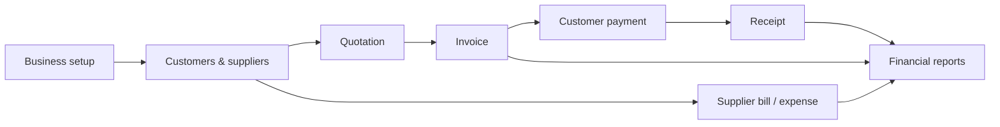

# ZEP ERP

**Financial clarity. Operational control. Built for growing businesses.**

ZEP ERP is a cloud-based financial management workspace designed for small and growing businesses, independent professionals, and service providers. It brings day-to-day billing, collections, expenses, payables, and financial reporting into one structured environment—helping business owners understand what they have earned, what they have collected, what they owe, and what remains outstanding.

**Website:** [zep-erp.vercel.app](https://zep-erp.vercel.app)  
**Repository:** [hasali-coder/ZEP_ERP](https://github.com/hasali-coder/ZEP_ERP)  
**Release status:** Active development · Controlled testing · Not yet approved for unrestricted production use

---

## At a glance

| Capability | Business value |
| --- | --- |
| Quotations and invoicing | Create customer-facing documents and track their lifecycle |
| Customer and supplier records | Maintain contacts, commercial terms, and linked financial history |
| Payments and receipts | Record customer collections, issue receipts, and track allocations |
| Expenses and supplier bills | Monitor operating outflows, payables, and recurring obligations |
| Credit notes | Document eligible invoice adjustments with an auditable reference |
| Financial reports | Review receivables, ageing, cash movements, management P&L, and statements of account |
| Multi-business workspaces | Manage separate businesses with tenant-scoped data access |
| Multi-currency records | Preserve original transaction currencies without assuming automatic FX conversion |

## How ZEP ERP works



**Sales and receivables.** A business creates a customer, prepares a quotation, converts an accepted quote into an invoice, and records payments against issued invoices. Receipts, balances, and customer statements are connected to the underlying records.

**Purchases and expenses.** Suppliers are linked to bills, direct expenses, and scheduled recurring obligations. Recurring dues are recorded separately from actual cash payments.

**Management reporting.** Business users can examine cash movements, outstanding balances, AR/AP ageing, and a management-oriented profit-and-loss view, with currency-aware reporting and document-level detail.

> **Accounting scope:** The current management P&L combines issued billing and recorded expenses. It is not represented as a complete statutory or accrual-basis financial statement. External tax, banking, and accounting integrations are not active.

## Product capabilities

- **Document lifecycle:** Quotations, invoices, receipts, and credit notes, with PDF exports and business branding.
- **Financial oversight:** Customer statements of account, receivables, payables, ageing, cash flow, and management analytics.
- **Operational records:** Customer/supplier profiles, transaction history, recurring expense schedules, and supporting attachments.
- **Security foundations:** Supabase Authentication, row-level security, business memberships, and database-validated financial actions.
- **Business configuration:** Company profile, logo, reporting currency, and payment instructions.

### Current development priorities

ZEP ERP remains under active QA. Priority work includes:

1. Completing supplier-bill settlement and customer-credit allocation workflows.
2. Adding reliable password recovery, editable drafts, and quotation revisions.
3. Strengthening financial audit trails, reconciliation, automated tests, and release controls.
4. Expanding document and reporting consistency checks, accessibility, and performance.

An integration settings interface may be present for future providers, but **external integrations are not yet enabled**.

---

## Technology

| Layer | Implementation |
| --- | --- |
| Frontend | React 19, TypeScript, Vite 8 |
| UI | Tailwind CSS, Lucide icons |
| Backend and identity | Supabase (PostgreSQL, Auth, Storage) |
| Financial logic | Supabase PostgreSQL functions and tenant-aware data access |
| Documents | Browser-generated PDF exports using `pdf-lib` |
| Hosting and deployment | Vercel, connected to GitHub |
| Local development | Node.js and npm |

### Repository layout

```text
.
├── public/                 # Public web assets
├── src/
│   ├── components/         # Screens, financial forms, and UI components
│   ├── context/            # Application state and data access coordination
│   ├── myzavo/             # Supabase-backed finance and reporting features
│   ├── services/           # Supporting services and legacy modules
│   └── main.tsx            # Application entry point
├── supabase/               # Local Supabase configuration and migrations
├── index.html              # Web application shell
├── package.json            # Scripts and dependencies
├── vite.config.ts          # Vite configuration
└── vercel.json             # Single-page-app route fallback
```

Some internal identifiers still retain the former **MyZavo** name for backward compatibility. The product's public brand is **ZEP ERP**.

## Local development

**Prerequisites:** Git, a compatible Node.js version, npm, and access to a Supabase project configured for this application's schema and permissions.

```bash
git clone https://github.com/hasali-coder/ZEP_ERP.git
cd ZEP_ERP
npm ci
```

Create a `.env.local` file at the project root:

```dotenv
VITE_SUPABASE_URL=https://YOUR_PROJECT_REF.supabase.co
VITE_SUPABASE_PUBLISHABLE_KEY=YOUR_SUPABASE_PUBLISHABLE_KEY
```

Find these values in **Supabase → Project Settings → API Keys**. Use a **publishable** key; never put a service-role or secret key in a `VITE_` variable. Frontend variables are embedded in the browser bundle.

Start the application:

```bash
npm run dev
```

Open **http://localhost:3000**. The application requires valid Supabase configuration to authenticate and access business records.

### Validation commands

```bash
npm run lint    # TypeScript check
npm run build   # Production bundle
npm run preview # Preview the built site
```

Run the TypeScript check **and** production build before submitting a change. A successful Vite build alone is not a complete QA pass.

## Deploying to Vercel

1. Import the GitHub repository into a Vercel project.
2. Select **Vite**, build command `npm run build`, and output directory `dist`.
3. Configure `VITE_SUPABASE_URL` and `VITE_SUPABASE_PUBLISHABLE_KEY` for the relevant deployment environments.
4. Deploy from the `main` branch, then verify `/`, `/login`, `/signup`, `/workspaces`, and authenticated `/app/...` routes.
5. Configure **Supabase Authentication → URL Configuration** to allow the deployed origin and the required authentication redirects.

The repository includes `vercel.json` to serve `index.html` for direct navigation to client-side routes. Changes to Vite environment variables require a **new deployment** to take effect.

**Production URL:** https://zep-erp.vercel.app

## Security and data handling

ZEP ERP is designed around authenticated users, business-scoped records, and Supabase row-level security. Sensitive financial operations use server-side database functions rather than relying exclusively on client-side validation.

The following practices are required for ongoing development:

- Do not commit `.env` files, private keys, credentials, customer exports, or database backups.
- Do not expose Supabase `service_role` or `sb_secret_` keys to the browser.
- Validate access boundaries across **different businesses and user roles**.
- Keep financial corrections traceable; prefer adjustments to destructive changes.
- Review changes to database functions, RLS policies, and migrations before deployment.
- Use an isolated testing environment for automated financial workflow tests.

**Security note:** The presence of RLS and server-side checks is not a substitute for a completed penetration test or independent security assessment.

## Development and contribution policy

The project is maintained as an actively developed application. Proposed changes should be scoped, reviewed, validated, and released through GitHub pull requests wherever possible.

Recommended release checks:

1. Document the issue, expected behaviour, and affected workflow.
2. Implement the change on a dedicated branch.
3. Run `npm run lint` and `npm run build`.
4. Test affected financial transactions, tenant isolation, and document outputs.
5. Review the pull request and deploy to a testing environment before production.

For defects or enhancements, use the repository's [Issues](https://github.com/hasali-coder/ZEP_ERP/issues) section. Do not include passwords, credentials, customer financial data, or authentication tokens in issue reports.

## Intellectual property

ZEP ERP and its source code are proprietary unless expressly licensed otherwise. Repository visibility does not, by itself, grant permission to reuse, redistribute, or commercialise the software.

---

**ZEP ERP** — *Make every financial decision with clarity.*
